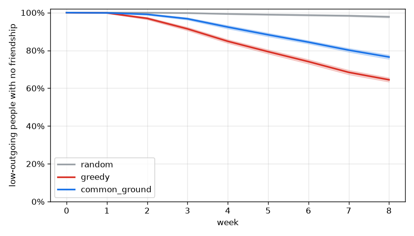

# Monte Carlo report: 20261112T214947Z_pool_sf_city_fake_tables

Pool `pool_sf_city`, 301 people, 698 plans over 8 weeks. 50 seeds x 25 sweep cells x 3 policies; world model `tables`; Laya tables FAKE (hash); matching: matching_adapter fallback. Main grid 102.5 s, total 189.3 s.

All results are relative comparisons between policies on a synthetic pool. They are not predictions about real users.

## Extraction and sensitive-gate eval

Not in this run (`cg-sim eval` writes `extraction.json` here; slice S2).

## Headline

No claim: Common Ground is better than greedy on "low-outgoing still isolated, week 8" in 0 of 25 cells and worse in 25. Center cell: Common Ground 76.5% [75.4%, 77.6%], greedy 64.5% [63.4%, 65.6%].

Shaded bands: 95% interval over seeds at flake x join = 1.0 x 1.0.

## Every metric (center cell, mean [95% interval] over seeds)

| Metric | random | greedy | common_ground |
| --- | --- | --- | --- |
| Low-outgoing still isolated, week 8 | 97.8% [97.2%, 98.3%] | 64.5% [63.4%, 65.6%] | 76.5% [75.4%, 77.6%] |
| People with >= 1 friendship, week 4 | 0.6% [0.4%, 0.7%] | 14.0% [13.4%, 14.7%] | 6.6% [6.0%, 7.2%] |
| People with >= 1 friendship, week 8 | 2.7% [2.3%, 3.1%] | 34.3% [33.7%, 35.0%] | 22.5% [21.8%, 23.2%] |
| Plan fill rate | 19.2% [18.9%, 19.6%] | 63.3% [63.0%, 63.7%] | 49.0% [48.6%, 49.3%] |
| Join-to-meetup rate | 22.8% [22.2%, 23.4%] | 42.3% [42.1%, 42.5%] | 38.0% [37.7%, 38.3%] |
| Show-up rate | 52.8% [52.1%, 53.4%] | 53.1% [52.9%, 53.3%] | 51.8% [51.5%, 52.1%] |
| Gini of friend counts | 0.96 [0.92, 0.99] | 0.76 [0.76, 0.77] | 0.83 [0.83, 0.84] |
| Median days to first meetup | 24.08 [23.36, 24.80] | 10.12 [9.73, 10.51] | 14.39 [13.95, 14.83] |
| Low-outgoing seated at least once | 58.6% [57.5%, 59.7%] | 82.5% [82.0%, 83.0%] | 79.9% [79.4%, 80.4%] |

## Robustness: Common Ground vs greedy across sweep cells

Seed-paired 95% interval of the difference per cell. A claim needs better in every cell.

| Metric | CG better | unclear | CG worse | claim |
| --- | --- | --- | --- | --- |
| Low-outgoing still isolated, week 8 | 0 | 0 | 25 | no |
| People with >= 1 friendship, week 4 | 0 | 0 | 25 | no |
| People with >= 1 friendship, week 8 | 0 | 0 | 25 | no |
| Plan fill rate | 0 | 0 | 25 | no |
| Join-to-meetup rate | 0 | 0 | 25 | no |
| Show-up rate | 0 | 0 | 25 | no |
| Gini of friend counts | 0 | 2 | 23 | no |
| Median days to first meetup | 0 | 0 | 25 | no |
| Low-outgoing seated at least once | 0 | 0 | 25 | no |

## Params ablations (Common Ground, center cell, seed-paired difference vs current params)

| Change | isolated low-outgoing w8 | friendship share w8 | fill rate |
| --- | --- | --- | --- |
| `maxPerActivityType=4` | -10.8% [-11.8%, -9.8%] | +10.9% [+10.2%, +11.5%] | +13.5% [+13.1%, +13.8%] |
| `exposureCapPerDay=20` | +0.5% [+0.0%, +1.0%] | -0.5% [-0.8%, -0.1%] | +0.5% [+0.4%, +0.6%] |
| `exposureCapPerDay=80` | +0.0% [+0.0%, +0.0%] | +0.0% [+0.0%, +0.0%] | +0.0% [+0.0%, +0.0%] |
| `isolationBoost=0` | +0.0% [+0.0%, +0.0%] | +0.0% [+0.0%, +0.0%] | +0.0% [+0.0%, +0.0%] |
| `isolationBoost=1` | +0.0% [+0.0%, +0.0%] | +0.0% [+0.0%, +0.0%] | +0.0% [+0.0%, +0.0%] |
| `formLeadHours=12` | -0.4% [-2.0%, +1.3%] | +0.7% [-0.4%, +1.7%] | +1.9% [+1.4%, +2.4%] |
| `formLeadHours=48` | +2.4% [+0.8%, +4.0%] | -1.3% [-2.2%, -0.4%] | -1.5% [-2.0%, -1.0%] |

## Recommended params.yaml changes

- `maxPerActivityType=4`: isolated low-outgoing share at week 8 changes by -10.8% (95% [-11.8%, -9.8%]), run `20261112T214947Z_pool_sf_city_fake_tables`. Propose via a `cg/contracts/` PR.

## Method notes

- Daily ticks; carousels (random: random eligible plans; greedy: most-joined then fit; common_ground: `rank_plans`), joins at p_join x join multiplier x 0.5 per impression x linear fatigue to 0 at `plans.openJoinsMax`, formation at formsAt (random/greedy first come in chunks of size.max; common_ground `form_groups`), show-up at 1 - (1 - p_show) x flake multiplier, meet-again per pair.
- Every policy sees the same people, the same weekly `propose_plans` inventory and the same random streams.
- Fake Laya tables ignore interests, so in fake mode p_join is scaled by interest fit.
