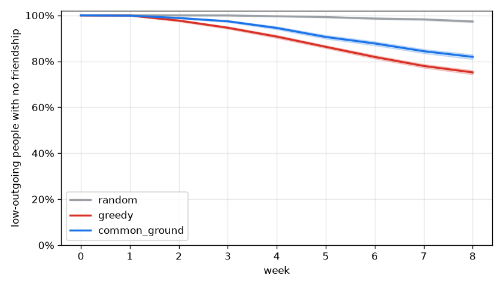

# Monte Carlo report: 20261112T221432Z_pool_sf_city_fake_tables

Pool `pool_sf_city`, 301 people, 698 plans over 8 weeks. 50 seeds x 25 sweep cells x 3 policies; world model `tables`; Laya tables FAKE (hash); matching: matching_adapter fallback. Main grid 471.0 s, total 761.1 s.

All results are relative comparisons between policies on a synthetic pool. They are not predictions about real users.

## Extraction and sensitive-gate eval

Not in this run (`cg-sim eval` writes `extraction.json` here; slice S2).

## Headline

No claim: Common Ground is better than greedy on "low-outgoing still isolated, week 8" in 0 of 25 cells and worse in 25. Center cell: Common Ground 81.9% [80.9%, 83.0%], greedy 75.2% [74.3%, 76.1%].

Shaded bands: 95% interval over seeds at flake x join = 1.0 x 1.0.

## Every metric (center cell, mean [95% interval] over seeds)

| Metric | random | greedy | common_ground |
| --- | --- | --- | --- |
| Low-outgoing still isolated, week 8 | 97.3% [96.8%, 97.8%] | 75.2% [74.3%, 76.1%] | 81.9% [80.9%, 83.0%] |
| People with >= 1 friendship, week 4 | 0.3% [0.2%, 0.4%] | 8.2% [7.6%, 8.7%] | 4.5% [4.1%, 4.9%] |
| People with >= 1 friendship, week 8 | 2.0% [1.6%, 2.3%] | 23.5% [22.8%, 24.2%] | 16.6% [15.9%, 17.3%] |
| Plan fill rate | 18.4% [18.2%, 18.7%] | 62.1% [61.8%, 62.5%] | 49.9% [49.5%, 50.3%] |
| Join-to-meetup rate | 22.8% [22.3%, 23.3%] | 40.4% [40.2%, 40.7%] | 36.6% [36.2%, 36.9%] |
| Show-up rate | 53.3% [52.6%, 53.9%] | 51.6% [51.3%, 51.8%] | 51.4% [51.0%, 51.7%] |
| Gini of friend counts | 0.90 [0.83, 0.98] | 0.83 [0.83, 0.84] | 0.87 [0.86, 0.87] |
| Median days to first meetup | 24.51 [23.65, 25.37] | 12.05 [11.44, 12.66] | 14.77 [14.47, 15.07] |
| Low-outgoing seated at least once | 56.2% [55.3%, 57.1%] | 83.9% [83.5%, 84.3%] | 82.1% [81.6%, 82.6%] |

## Robustness: Common Ground vs greedy across sweep cells

Seed-paired 95% interval of the difference per cell. A claim needs better in every cell.

| Metric | CG better | unclear | CG worse | claim |
| --- | --- | --- | --- | --- |
| Low-outgoing still isolated, week 8 | 0 | 0 | 25 | no |
| People with >= 1 friendship, week 4 | 0 | 0 | 25 | no |
| People with >= 1 friendship, week 8 | 0 | 0 | 25 | no |
| Plan fill rate | 0 | 0 | 25 | no |
| Join-to-meetup rate | 0 | 0 | 25 | no |
| Show-up rate | 0 | 12 | 13 | no |
| Gini of friend counts | 0 | 2 | 23 | no |
| Median days to first meetup | 0 | 2 | 23 | no |
| Low-outgoing seated at least once | 0 | 0 | 25 | no |

## Params ablations (Common Ground, center cell, seed-paired difference vs current params)

| Change | isolated low-outgoing w8 | friendship share w8 | fill rate |
| --- | --- | --- | --- |
| `maxPerActivityType=4` | -2.0% [-2.6%, -1.4%] | +2.5% [+2.1%, +3.0%] | +4.4% [+4.2%, +4.6%] |
| `exposureCapPerDay=20` | +0.1% [-0.1%, +0.3%] | -0.2% [-0.4%, +0.1%] | +0.1% [+0.0%, +0.2%] |
| `exposureCapPerDay=80` | +0.0% [+0.0%, +0.0%] | +0.0% [+0.0%, +0.0%] | +0.0% [+0.0%, +0.0%] |
| `exposureCapPerDay=10` | +1.9% [+1.3%, +2.5%] | -2.5% [-3.0%, -2.0%] | -0.5% [-0.7%, -0.2%] |
| `exposureCapPerDay=10,isolationBoost=0` | +1.5% [+0.9%, +2.0%] | -2.1% [-2.6%, -1.7%] | -0.4% [-0.7%, -0.2%] |
| `exposureCapPerDay=10,isolationBoost=1` | +1.9% [+1.3%, +2.5%] | -2.6% [-3.1%, -2.1%] | -0.4% [-0.7%, -0.1%] |
| `isolationBoost=0` | +0.0% [+0.0%, +0.0%] | +0.0% [+0.0%, +0.0%] | +0.0% [+0.0%, +0.0%] |
| `isolationBoost=1` | +0.0% [+0.0%, +0.0%] | +0.0% [+0.0%, +0.0%] | +0.0% [+0.0%, +0.0%] |
| `formLeadHours=12` | -1.0% [-2.3%, +0.3%] | +1.1% [+0.2%, +2.1%] | +1.7% [+1.2%, +2.2%] |
| `formLeadHours=48` | +1.6% [+0.2%, +2.9%] | -1.0% [-1.9%, -0.2%] | -1.9% [-2.4%, -1.4%] |

`isolationBoost` only reorders contested exposures: at the default cap no plan hits `exposureCapPerDay`, so its rows are exactly zero; the cap-10 rows show it where it binds.

## Recommended params.yaml changes

- Withheld: Common Ground ran on the matching_adapter fallback; the headline has no claim; Laya tables are fake. The ablation table above is exploratory, not evidence.

## Method notes

- Daily ticks; carousels (random: random eligible plans; greedy: most-joined then fit; common_ground: `rank_plans`), joins at p_join x join multiplier x 0.5 per impression x linear fatigue to 0 at `plans.openJoinsMax`, formation at formsAt (random/greedy first come in chunks of size.max; common_ground `form_groups`), show-up at 1 - (1 - p_show) x flake multiplier, meet-again per pair.
- Every policy sees the same people, the same weekly `propose_plans` inventory and the same random streams.
- Fake Laya tables ignore interests, so in fake mode p_join is scaled by interest fit.
