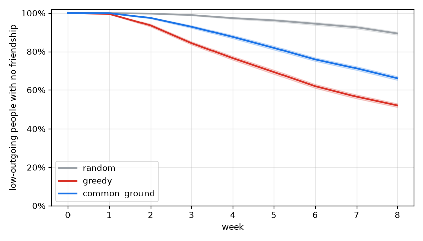

# Monte Carlo report: 20261112T224057Z_pool_sf_city_fake_tables

Pool `pool_sf_city`, 301 people, 960 plans over 8 weeks. 50 seeds x 25 sweep cells x 3 policies; world model `tables`; Laya tables FAKE (hash); matching: cg_matching. Main grid 865.1 s, total 1421.7 s.

All results are relative comparisons between policies on a synthetic pool. They are not predictions about real users.

## Extraction and sensitive-gate eval

Not in this run (`cg-sim eval` writes `extraction.json` here; slice S2).

## Headline

No claim: Common Ground is better than greedy on "low-outgoing still isolated, week 8" in 0 of 25 cells and worse in 25. Center cell: Common Ground 66.1% [65.1%, 67.1%], greedy 52.0% [51.0%, 52.9%].

Shaded bands: 95% interval over seeds at flake x join = 1.0 x 1.0.

## Every metric (center cell, mean [95% interval] over seeds)

| Metric | random | greedy | common_ground |
| --- | --- | --- | --- |
| Low-outgoing still isolated, week 8 | 89.4% [88.6%, 90.2%] | 52.0% [51.0%, 52.9%] | 66.1% [65.1%, 67.1%] |
| People with >= 1 friendship, week 4 | 2.5% [2.2%, 2.8%] | 23.2% [22.5%, 23.9%] | 11.3% [10.7%, 11.9%] |
| People with >= 1 friendship, week 8 | 10.1% [9.6%, 10.7%] | 48.6% [48.0%, 49.3%] | 32.6% [31.9%, 33.3%] |
| Plan fill rate | 42.8% [42.5%, 43.2%] | 81.1% [80.9%, 81.3%] | 78.1% [77.9%, 78.3%] |
| Join-to-meetup rate | 32.0% [31.7%, 32.3%] | 43.0% [42.8%, 43.2%] | 39.6% [39.4%, 39.8%] |
| Show-up rate | 49.7% [49.4%, 50.1%] | 50.2% [50.0%, 50.4%] | 53.5% [53.4%, 53.7%] |
| Gini of friend counts | 0.92 [0.91, 0.92] | 0.67 [0.67, 0.68] | 0.75 [0.75, 0.76] |
| Median days to first meetup | 15.38 [15.19, 15.57] | 7.72 [7.59, 7.85] | 8.18 [8.08, 8.28] |
| Low-outgoing seated at least once | 79.2% [78.7%, 79.7%] | 85.5% [85.4%, 85.6%] | 84.7% [84.5%, 84.9%] |

## Robustness: Common Ground vs greedy across sweep cells

Seed-paired 95% interval of the difference per cell. A claim needs better in every cell. Not evidence: fake Laya tables (Common Ground ranks on the same hashed p_show/p_join the world draws outcomes from); needs real Laya tables.

| Metric | CG better | unclear | CG worse | claim |
| --- | --- | --- | --- | --- |
| Low-outgoing still isolated, week 8 | 0 | 0 | 25 | no |
| People with >= 1 friendship, week 4 | 0 | 0 | 25 | no |
| People with >= 1 friendship, week 8 | 0 | 0 | 25 | no |
| Plan fill rate | 0 | 0 | 25 | no |
| Join-to-meetup rate | 0 | 0 | 25 | no |
| Show-up rate | 25 | 0 | 0 | not evidence |
| Gini of friend counts | 0 | 0 | 25 | no |
| Median days to first meetup | 0 | 0 | 25 | no |
| Low-outgoing seated at least once | 0 | 0 | 25 | no |

## Params ablations (Common Ground, center cell, seed-paired difference vs current params)

| Change | isolated low-outgoing w8 | friendship share w8 | fill rate |
| --- | --- | --- | --- |
| `maxPerActivityType=4` | -3.7% [-4.9%, -2.4%] | +4.1% [+3.5%, +4.7%] | +2.5% [+2.3%, +2.8%] |
| `caps lifted (type=8,scene=8,fillFloor=0)` | -4.4% [-5.6%, -3.3%] | +5.6% [+4.9%, +6.3%] | +4.1% [+3.9%, +4.4%] |
| `exposureCapPerDay=20` | -0.2% [-1.1%, +0.8%] | -0.2% [-0.7%, +0.3%] | +0.2% [+0.0%, +0.4%] |
| `exposureCapPerDay=80` | -0.1% [-0.7%, +0.5%] | -0.1% [-0.5%, +0.2%] | +0.0% [-0.1%, +0.1%] |
| `exposureCapPerDay=10` | -0.8% [-1.9%, +0.3%] | +1.0% [+0.2%, +1.7%] | +0.6% [+0.4%, +0.8%] |
| `exposureCapPerDay=10,isolationBoost=0` | -1.4% [-2.6%, -0.1%] | +1.4% [+0.6%, +2.2%] | +0.5% [+0.3%, +0.7%] |
| `exposureCapPerDay=10,isolationBoost=1` | -0.3% [-1.3%, +0.6%] | +0.9% [+0.2%, +1.6%] | +0.5% [+0.3%, +0.8%] |
| `isolationBoost=0` | -0.0% [-0.1%, +0.1%] | -0.0% [-0.1%, +0.1%] | -0.0% [-0.0%, +0.0%] |
| `isolationBoost=1` | +0.1% [-0.1%, +0.2%] | -0.1% [-0.3%, +0.1%] | -0.0% [-0.1%, +0.0%] |
| `formLeadHours=12` | +0.4% [-1.1%, +1.9%] | -0.7% [-1.5%, +0.1%] | +0.4% [+0.0%, +0.7%] |
| `formLeadHours=48` | +1.0% [-0.4%, +2.5%] | -0.3% [-1.3%, +0.6%] | -0.7% [-1.0%, -0.4%] |

`isolationBoost` only reorders contested exposures: at the default cap no plan hits `exposureCapPerDay`, so its rows sit at about zero; the cap-10 rows show it where it binds.

## Recommended params.yaml changes

- Withheld: the headline has no claim; Laya tables are fake. The ablation table above is exploratory, not evidence.

## Method notes

- Daily ticks; carousels (random: random eligible plans; greedy: most-joined then fit; common_ground: `rank_plans`), joins at p_join x join multiplier x 0.5 per impression x linear fatigue to 0 at `plans.openJoinsMax`, formation at formsAt (random/greedy first come in chunks of size.max; common_ground `form_groups`), show-up at 1 - (1 - p_show) x flake multiplier, meet-again per pair.
- Every policy sees the same people, the same weekly `propose_plans` inventory and the same random streams.
- Fake Laya tables ignore interests, so in fake mode p_join is scaled by interest fit.
