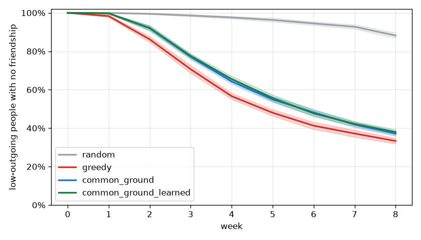

# Monte Carlo report: real_laya_center

Pool `pool_sf_city`, 301 people, 960 plans over 8 weeks. 20 seeds x 1 sweep cells x 4 policies; world model `tables`; Laya tables precomputed; matching: cg_matching. Main grid 72.7 s, total 81.1 s.

All results are relative comparisons between policies on a synthetic pool. They are not predictions about real users.

## Extraction and sensitive-gate eval

Not in this run (`cg-sim eval` writes `extraction.json` here; slice S2).

## Headline

No claim: Common Ground is better than greedy on "low-outgoing still isolated, week 8" in 0 of 1 cells and worse in 1. Center cell: Common Ground 37.2% [35.9%, 38.5%], greedy 33.3% [31.8%, 34.8%].

Shaded bands: 95% interval over seeds at flake x join = 1.0 x 1.0.

## Every metric (center cell, mean [95% interval] over seeds)

| Metric | random | greedy | common_ground | common_ground_learned |
| --- | --- | --- | --- | --- |
| Low-outgoing still isolated, week 8 | 88.2% [86.8%, 89.6%] | 33.3% [31.8%, 34.8%] | 37.2% [35.9%, 38.5%] | 37.9% [36.5%, 39.3%] |
| People with >= 1 friendship, week 4 | 2.6% [2.0%, 3.2%] | 43.4% [42.4%, 44.4%] | 37.2% [36.3%, 38.0%] | 36.9% [35.9%, 38.0%] |
| People with >= 1 friendship, week 8 | 13.4% [12.2%, 14.6%] | 68.0% [67.3%, 68.8%] | 65.0% [64.2%, 65.8%] | 65.1% [64.2%, 66.0%] |
| Plan fill rate | 93.5% [93.2%, 93.8%] | 83.3% [83.0%, 83.7%] | 77.6% [77.3%, 77.9%] | 77.4% [77.1%, 77.8%] |
| Join-to-meetup rate | 30.5% [30.2%, 30.8%] | 51.9% [51.6%, 52.2%] | 35.9% [35.6%, 36.2%] | 35.8% [35.5%, 36.2%] |
| Show-up rate | 36.9% [36.7%, 37.2%] | 58.3% [58.0%, 58.6%] | 56.6% [56.3%, 56.9%] | 56.6% [56.3%, 56.9%] |
| Gini of friend counts | 0.88 [0.87, 0.89] | 0.57 [0.56, 0.58] | 0.57 [0.57, 0.58] | 0.57 [0.57, 0.58] |
| Median days to first meetup | 8.00 [8.00, 8.00] | 4.45 [4.18, 4.72] | 7.95 [7.85, 8.05] | 7.95 [7.85, 8.05] |
| Low-outgoing seated at least once | 96.9% [96.9%, 96.9%] | 84.7% [84.7%, 84.7%] | 92.7% [92.5%, 92.9%] | 92.8% [92.6%, 92.9%] |

## Robustness: Common Ground vs greedy across sweep cells

Seed-paired 95% interval of the difference per cell. A claim needs better in every cell.

| Metric | CG better | unclear | CG worse | claim |
| --- | --- | --- | --- | --- |
| Low-outgoing still isolated, week 8 | 0 | 0 | 1 | no |
| People with >= 1 friendship, week 4 | 0 | 0 | 1 | no |
| People with >= 1 friendship, week 8 | 0 | 0 | 1 | no |
| Plan fill rate | 0 | 0 | 1 | no |
| Join-to-meetup rate | 0 | 0 | 1 | no |
| Show-up rate | 0 | 0 | 1 | no |
| Gini of friend counts | 0 | 1 | 0 | no |
| Median days to first meetup | 0 | 0 | 1 | no |
| Low-outgoing seated at least once | 1 | 0 | 0 | yes |

## Learned prefs vs plain Common Ground (center cell)

`common_ground_learned` = common_ground plus `MatchState.prefs` from `cg_matching.update_prefs` after each meetup (+0.5 if I'd meet someone again, -0.5 otherwise or for my no-show).

| week | show rate CG | show rate learned | friend share CG | friend share learned |
| --- | --- | --- | --- | --- |
| 1 | 61.6% | 61.7% | 0.2% | 0.2% |
| 2 | 56.7% | 56.6% | 9.1% | 9.0% |
| 3 | 55.8% | 55.5% | 24.5% | 24.1% |
| 4 | 57.4% | 57.6% | 37.2% | 36.9% |
| 5 | 57.2% | 56.7% | 47.0% | 46.9% |
| 6 | 56.6% | 56.8% | 54.5% | 54.5% |
| 7 | 56.6% | 56.6% | 60.4% | 60.4% |
| 8 | 54.9% | 55.1% | 65.0% | 65.1% |

| week 8, learned - CG (seed-paired 95%) | difference | verdict |
| --- | --- | --- |
| Low-outgoing still isolated, week 8 | +0.7% [-0.6%, +2.0%] | unclear |
| People with >= 1 friendship, week 8 | +0.1% [-0.7%, +1.0%] | unclear |
| Show-up rate | -0.1% [-0.2%, +0.1%] | unclear |

## Method notes

- Daily ticks; carousels (random: random eligible plans; greedy: most-joined then fit; common_ground: `rank_plans`), joins at p_join x join multiplier x 0.5 per impression x linear fatigue to 0 at `plans.openJoinsMax`, formation at formsAt (random/greedy first come in chunks of size.max; common_ground `form_groups`), show-up at 1 - (1 - p_show) x flake multiplier, meet-again per pair.
- Every policy sees the same people, the same weekly `propose_plans` inventory and the same random streams.
- Laya tables from data/sim/laya_gt.
