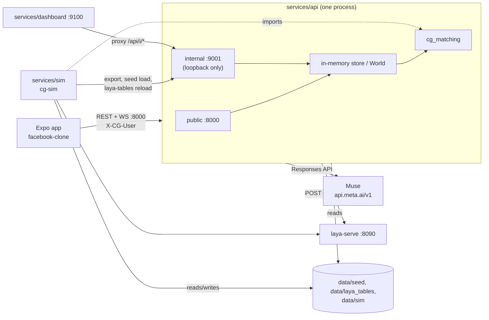

# Common Ground: system docs

How the running system fits together. Every fact cites code or config on `main`; anything unverified is marked **TODO**. Contracts win over these pages: [`contracts/CONTRACTS.md`](../../../contracts/CONTRACTS.md).

| Page | Covers |
| --- | --- |
| [backend.md](backend.md) | `services/api`: app factory, ports, store, realtime, privacy, errors |
| [matching-ml.md](matching-ml.md) | `cg_matching` ranking, grouping, scenes, learning loop, `params.yaml` values |
| [muse.md](muse.md) | Muse API use, off-request-path cache, precompute, fallbacks |
| [laya.md](laya.md) | Laya server, questions, tables, precompute |
| [sim.md](sim.md) | Seed, Monte Carlo, param evidence, dashboard |
| [app.md](app.md) | `facebook-clone` Common Ground feature |
| [e2e.md](e2e.md) | The demo flow end to end, `scripts/e2e_flow.py`, known gaps |
| [runbook.md](runbook.md) | Run the whole demo locally; common failures |
| [decisions.md](decisions.md) | Dated decisions |
| [perf-and-bugs.md](perf-and-bugs.md) | Adversarial track: P1 to P11 results, perf and bug findings with numbers and PRs |

## Overview

Common Ground is a plans-first Facebook feature. The Expo app (`facebook-clone/`) talks only to the backend's public API (`:8000`, header `X-CG-User`, WebSocket `/v1/ws`). The backend (`services/api`) keeps one in-memory world loaded from `data/seed/<pool>`, ranks plans and forms groups with `packages/matching` (`cg_matching`), and calls two model peers: **Muse** (`api.meta.ai`, OpenAI-compatible Responses API: text understanding and copy) and **Laya** (`laya-serve` on `:8090`: yes/no probabilities for sensitivity, join, show-up, meet-again). Muse is kept off the request path wherever possible (background cache). The simulation (`services/sim`) and laptop dashboard (`services/dashboard`) use the loopback-only internal API (`:9001`); the sim imports the same `cg_matching` and `params.yaml`.

Source: `services/api/src/cg_api/app.py`, `cli.py`, `contracts/CONTRACTS.md` §12, `services/dashboard/src/cg_dashboard/app.py`.
