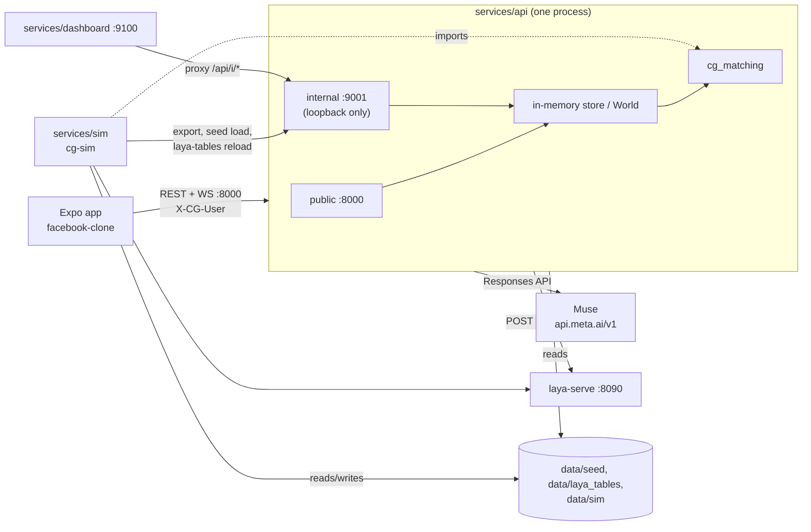

# Meetups (Common Ground): system docs

How the running system fits together. **Meetups** is the user-facing name of the feature (renamed from Plans in #144 to #148); "Common Ground" stays the internal and code name (`facebook-clone/src/features/common-ground`, `cg_api`, `cg_matching`, `cg_sim`). Every fact cites code or config on `main`; anything unverified is marked **TODO**. Contracts win over these pages: [`contracts/CONTRACTS.md`](../../../contracts/CONTRACTS.md).

**Start here on demo day: [status.md](status.md).** It has what is merged, what runs where, the demo-day checklist, what is real vs synthetic, and the known gaps.

| Page | Covers |
| --- | --- |
| [status.md](status.md) | Demo-freeze status: full merged-PR history by area, what runs where, demo-day checklist and flow script, real vs synthetic, known gaps, post-hackathon to-dos |
| [runbook.md](runbook.md) | Exact commands to run the whole demo stack locally; ports; common failures |
| [backend.md](backend.md) | `services/api`: app factory, ports, store, realtime, privacy, errors |
| [matching-ml.md](matching-ml.md) | `cg_matching` ranking, grouping, scenes, learning loop, `params.yaml` values |
| [muse.md](muse.md) | Muse (Meta's LLM API, `muse-spark-1.3`): use, off-request-path cache, precompute, fallbacks |
| [laya.md](laya.md) | Laya (`laya-serve`, local probability model): server, questions, tables, precompute |
| [sim.md](sim.md) | Seed, Monte Carlo, param evidence, dashboard |
| [app.md](app.md) | `facebook-clone` Meetups feature: screens, state, realtime, motion |
| [e2e.md](e2e.md) | The demo flow end to end, `scripts/e2e_flow.py`, known gaps, flow/motion review (9 / 9) |
| [ux-audit.md](ux-audit.md) | UX audit: uniformity 9.0, UX 9.0 on native iOS (from 7.0 / 6.9); method, measurements, before/after, open items |
| [perf-and-bugs.md](perf-and-bugs.md) | Adversarial track: privacy P1 to P11, perf and race findings with before/after numbers and PRs |
| [decisions.md](decisions.md) | Dated decisions |

Outside this folder: [`HUMAN_TODO.md`](../../../HUMAN_TODO.md) (steps only a person can do, pitch numbers), [`CHECKPOINT_B.md`](../../../CHECKPOINT_B.md) (device test script), [`docs/common-ground/README.md`](../README.md) (design, agent rules, PRDs).

## Overview

Meetups (Common Ground) is a plans-first Facebook feature. The Expo app (`facebook-clone/`) talks only to the backend's public API (`:8000`, header `X-CG-User`, WebSocket `/v1/ws`). The backend (`services/api`) keeps one in-memory world loaded from `data/seed/<pool>`, ranks plans and forms groups with `packages/matching` (`cg_matching`), and calls two model peers: **Muse** (`api.meta.ai`, OpenAI-compatible Responses API: text understanding and copy) and **Laya** (`laya-serve` on `:8090`: yes/no probabilities for sensitivity, join, show-up, meet-again). Muse is kept off the request path wherever possible (background cache). The simulation (`services/sim`) and laptop dashboard (`services/dashboard`) use the loopback-only internal API (`:9001`); the sim imports the same `cg_matching` and `params.yaml`.

Source: `services/api/src/cg_api/app.py`, `cli.py`, `contracts/CONTRACTS.md` §12, `services/dashboard/src/cg_dashboard/app.py`.
