# Reference pack and evidence

## Source priority

1. **Desktop Home:** [Facebook Basics 2025, slide 5](https://www.scscc.club/smnr/FacebookBasics2025.pdf) controls the overall desktop shell, column order, feed density, and placement. Use [the local slide](references/images/desktop-home-slide-05.png) and [UI crop](references/images/desktop-home-ui.png).
2. **Profile:** The same guide, [slide 8](references/images/desktop-profile-slide-08.png), controls the cover, avatar overlap, action row, tabs, and two-column profile body. Use [the UI crop](references/images/desktop-profile-ui.png) for closer inspection.
3. **Account menu and Settings:** [Senior Planet's 2025 walkthrough](https://seniorplanet.org/wp-content/uploads/2025/09/Using-View-As-on-Facebook-Profile-handout-for-SMT-9.11.25.pdf) controls the menu hierarchy, audience picker, and Settings categories. The original URL returned 404 on 11 November 2026; the included PDF was recovered from [the 1 October 2025 web archive capture](https://web.archive.org/web/20251001021747id_/https://seniorplanet.org/wp-content/uploads/2025/09/Using-View-As-on-Facebook-Profile-handout-for-SMT-9.11.25.pdf).
4. **Narrow screens:** [Singapore Digital for Life's 2026 Social Media guide](https://files.app.optical.gov.sg/digital4life/production/assets/b005fecc-c573-41af-9626-82f57215c411.pdf) provides phone screens for [Home](references/images/mobile-home-2026-ui.png), [Profile](references/images/mobile-profile-2026-ui.png), [Friends](references/images/mobile-friends-2026-ui.png), [Menu](references/images/mobile-menu-2026-ui.png), and [Settings](references/images/mobile-settings-2026-ui.png). The [Marketing Crowd slide 41](references/images/mobile-feed-slide-41.png) remains a secondary feed example because its screenshots look older and are business-oriented.
5. **Friends and Marketplace detail:** [Desktop Friends](references/images/desktop-friends-guidingtech.png), [desktop Marketplace](references/images/desktop-marketplace-moonlock.webp), and [mobile Marketplace](references/images/mobile-marketplace-2026-ui.png) fill gaps in the original guides. Their provenance and limits are in the [source atlas](SOURCE_ATLAS.md).
6. **Newer behavior and brand:** [Meta's December 2025 Feed update](https://about.fb.com/news/2025/12/making-it-easier-to-create-discover-and-share-content-on-facebook/) supports a standardized multi-photo grid, prominent mobile destinations, and visible audience control in the composer. [Meta's Facebook logo guidance](https://www.meta.com/brand/resources/facebook/logo/) is authoritative for logo treatment. [AI Web Style's palette](https://www.aiwebstyle.com/styles/facebook.html) is a secondary token reference; it does not override the screenshots or Meta's brand rules.

These references show different product versions. The app should read as one interface: use slide 5's white desktop header and three-column Home, slide 8's Profile structure, Senior Planet's settings hierarchy, and a mobile adaptation of the same visual language. Do not combine the business-page navigation or the purple teaching-slide styling with the personal-account clone. The [source atlas](SOURCE_ATLAS.md) lists every added source and its limits.

## Local source files

| Local file | Origin | Use |
| --- | --- | --- |
| [desktop-guide-2025.pdf](references/source/desktop-guide-2025.pdf) | Sun City Summerlin Computer Club, *Facebook Basics 2025* | Full desktop guide, including slides 5–11 |
| [profile-settings-walkthrough-2025.pdf](references/source/profile-settings-walkthrough-2025.pdf) | Senior Planet from AARP, archived copy | Four-page profile, audience, and Settings walkthrough |
| [mobile-example-2026.pdf](references/source/mobile-example-2026.pdf) | The Marketing Crowd, February 2026 | Full business-marketing deck; slide 41 has the relevant phone screenshots |

The local PDFs preserve every image in the three original supplied guides. The 52.8 MB Digital for Life PDF is linked in the [source atlas](SOURCE_ATLAS.md); 18 relevant rendered pages and five UI crops from it are saved locally, plus a separate App Store Marketplace crop. The rendered files below make the target screens quick to inspect. PDF page numbers in file names are **1-based**.

## Rendered image inventory

| Image | What to inspect |
| --- | --- |
| [Desktop Home slide 5](references/images/desktop-home-slide-05.png), [UI crop](references/images/desktop-home-ui.png) | Header, left navigation, composer, stories, first post, contacts |
| [Desktop navigation slide 6](references/images/desktop-navigation-slide-06.png) | Exact visible top destinations and icon order |
| [Desktop sidebar slide 7](references/images/desktop-sidebar-slide-07.png) | Exact visible left destinations |
| [Desktop Profile slide 8](references/images/desktop-profile-slide-08.png), [UI crop](references/images/desktop-profile-ui.png) | Cover, avatar, actions, friend suggestions, tabs, Intro, composer |
| [Desktop composer slide 10](references/images/desktop-composer-slide-10.png) | Composer row and action spacing |
| [Desktop Messenger slide 11](references/images/desktop-messenger-slide-11.png) | Chat drawer/window proportions |
| [Profile walkthrough page 1](references/images/profile-walkthrough-page-01.png) | Entry to the profile from Home/header |
| [Profile “View As” page 2](references/images/profile-view-as-page-02.png) | Profile overflow menu and public-view layout |
| [Audience page 3](references/images/audience-selector-page-03.png), [selector crop](references/images/audience-selector-ui.png) | Radio-list audience picker and active value |
| [Account/Settings page 4](references/images/account-menu-settings-page-04.png), [menu crop](references/images/account-menu-ui.png), [Settings crop](references/images/settings-sections-ui.png) | Profile dropdown → Settings & privacy → Settings; Audience and visibility section |
| [Mobile slide 41](references/images/mobile-feed-slide-41.png), [phone crop](references/images/mobile-feed-ui.png) | One-column feed, stories, controls, bottom navigation |
| [Digital for Life Home](references/images/mobile-home-2026-ui.png), [Profile](references/images/mobile-profile-2026-ui.png), [Friends](references/images/mobile-friends-2026-ui.png), [Menu](references/images/mobile-menu-2026-ui.png), [Settings](references/images/mobile-settings-2026-ui.png) | 2026 phone UI crops; [all 18 full pages](SOURCE_ATLAS.md#mobile-screen-map) retain their captions and context |
| [Desktop Friends](references/images/desktop-friends-guidingtech.png), [desktop Marketplace](references/images/desktop-marketplace-moonlock.webp), [Shopify Marketplace](references/images/desktop-marketplace-shopify.png), [mobile Marketplace](references/images/mobile-marketplace-2026-ui.png) | Supplementary page layouts and card density; inspect [source notes](SOURCE_ATLAS.md) before borrowing details |
| [Meta Feed-update image](references/images/meta-feed-update-header.png) | Official brand/context image; **not** a literal UI layout reference |

## Visual gallery

These crops keep the original reference pixels and omit most slide framing. Open the linked full slides above to inspect context and publisher annotations.

**Desktop Home — primary target**

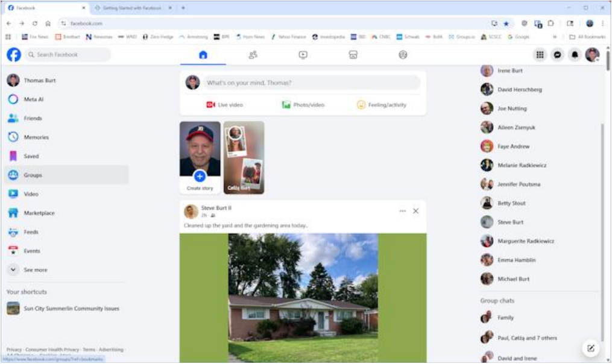

**Desktop Profile**

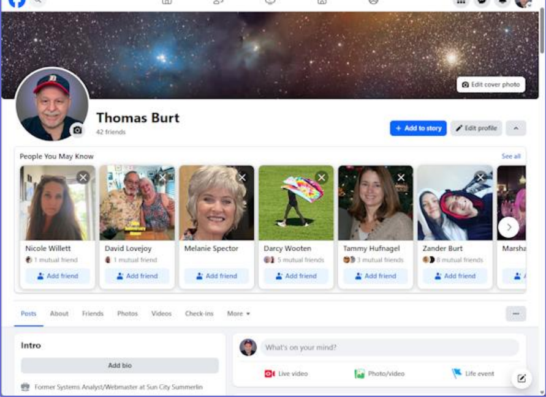

**Account menu and Settings categories**

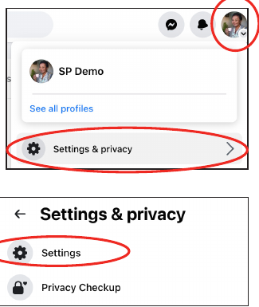

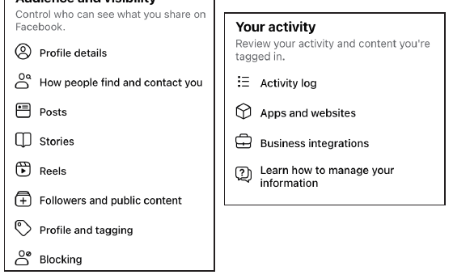

**Audience selector**

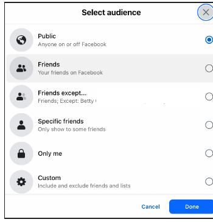

**Mobile Home, Profile, Friends, Marketplace, and Settings**

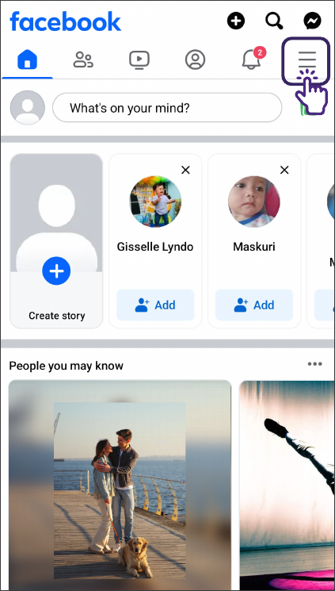

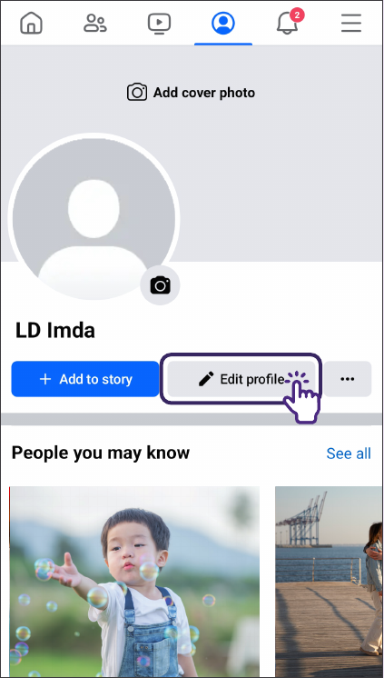

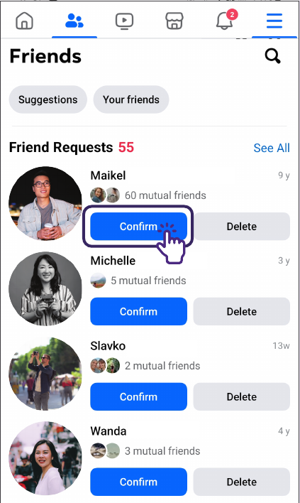

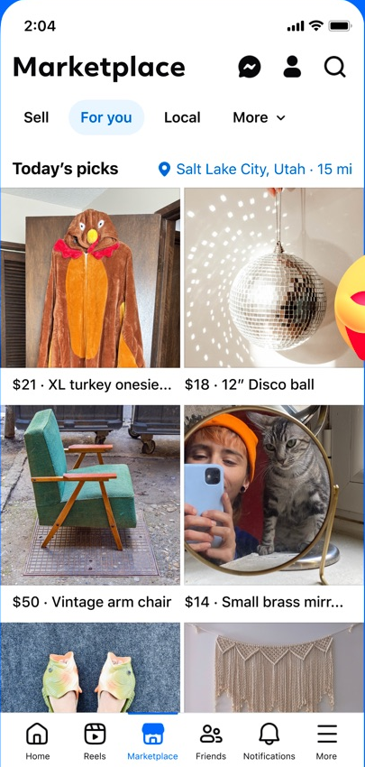

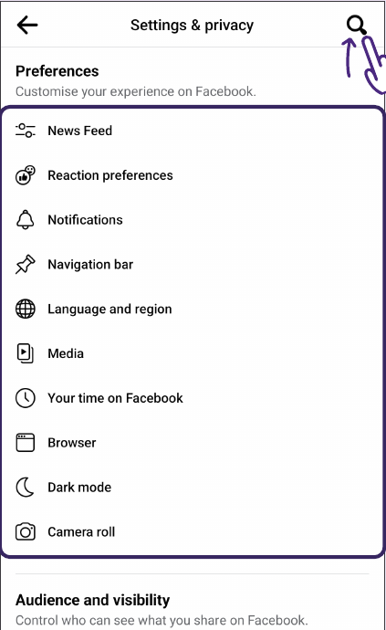

**Older mobile feed example**

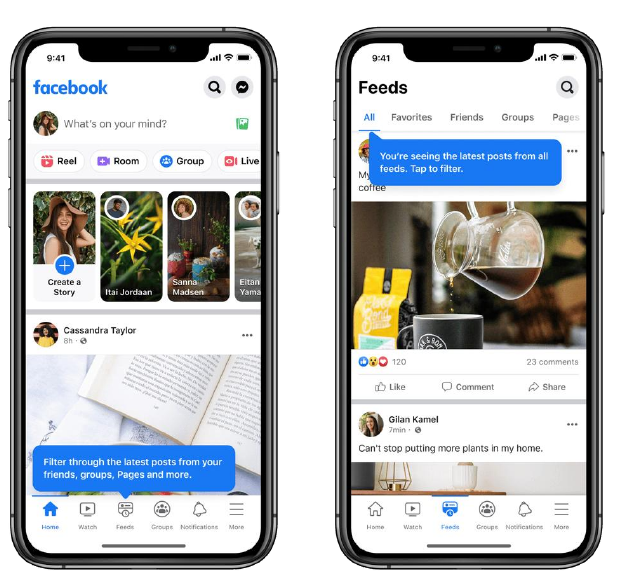

## Visual observations from the actual images

The Home screenshot is embedded in a slide and has been scaled down, so its pixels cannot be treated as native CSS pixels. In the [1015 × 604 UI crop](references/images/desktop-home-ui.png), the left rail occupies roughly 21%, the feed card roughly 41%, and the contacts rail roughly 21% of the screenshot width. The remaining width is mostly the two gaps. At 1440 px this suggests a center feed closer to **590–620 px** than the brief's provisional 680 px. Confirm against a running screenshot before finalizing the width.

| Region in the 1015 × 604 crop | Approximate raster bounds | Implementation implication |
| --- | --- | --- |
| Facebook header, below browser chrome | `y 77–111` | Roughly 48 px if the embedded image is scaled to 1440 px; the brief's 56 px remains a sound first pass |
| Left navigation | `x 0–215` | Roughly 300 px at 1440 px |
| Center composer/cards | `x 296–709` | Roughly 585 px at 1440 px |
| Right contacts | `x 795–1015` | Roughly 310 px at 1440 px |
| Composer, stories, first post starts | `y 117–191`, `201–322`, `330` | Compact, roughly 10–12 px gaps in the scaled image |

The source is a screenshot inside a PDF slide and includes browser chrome. These are measurements of the raster reference, **not** claims about Facebook's CSS. Use them to set proportions, then adjust the running app by screenshot comparison.

The Profile crop shows a wide cover across the profile container, an overlapping circular avatar, name and friend count beside it, action buttons on the right, a horizontal tab row, then an Intro column beside the post column. The desktop guide's header and the profile walkthrough both use a white header with a blue circular mark. The mobile phone screenshot shows a distinct top row, horizontal stories, edge-to-edge feed cards, and bottom navigation.

The Senior Planet handout visibly shows a **two-step account menu**: profile avatar → Settings & privacy → Settings. It also shows “Audience and visibility” in Settings and an audience dialog with Public, Friends, Friends except…, Specific friends, Only me, and Custom. The demo needs only the functioning audience choices specified in [Content and interactions](CONTENT_AND_INTERACTIONS.md); do not display unsupported choices as active controls.

## Brand handling

Meta describes the current Facebook logo as a complete white “f” inside a blue circle. It says to use the current official mark, keep it unaltered, give it at least one-quarter of its width as clear space, and keep it at least 16 px wide in digital use. It specifically warns against using a standalone “f” or the wordmark in place of the logo. Use the [official resource page](https://www.meta.com/brand/resources/facebook/logo/) when adding the app asset; do not infer logo geometry from the low-resolution slide images. The [Meta Feed-update image](references/images/meta-feed-update-header.png) is included as visual context, not as a substitute logo asset.

## Reproduction and provenance

The desktop slide images were rendered from PDF pages 5, 6, 7, 8, 10, and 11. The settings images came from pages 2–4 of the archived Senior Planet PDF. The older mobile image came from PDF page 41. The added mobile pages were rendered from the Digital for Life PDF and the supplementary images were downloaded from the publishers/Apple image CDN listed in the [source atlas](SOURCE_ATLAS.md). Crops contain source pixels without retouching. All selected images are local so Astra can inspect them offline. Keep third-party reference assets inside `docs/references`; app runtime media belongs separately under the app's public assets directory and must use fictional/demo content.
